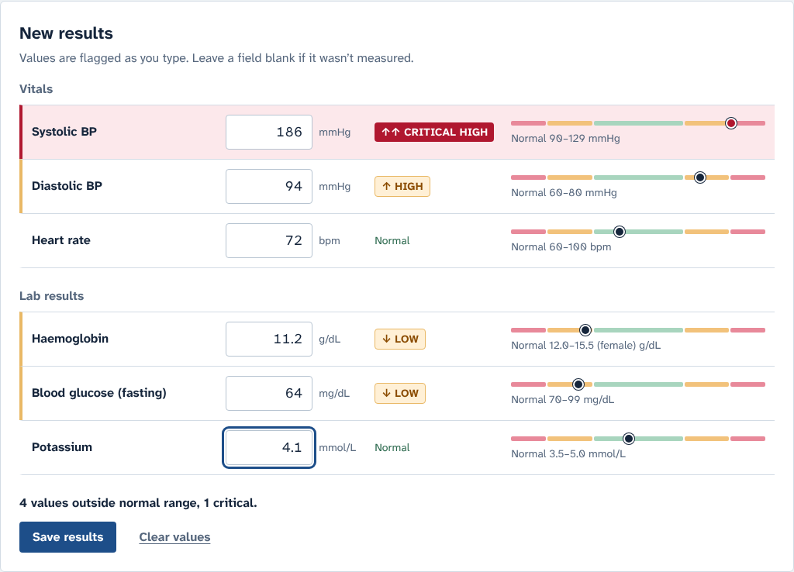
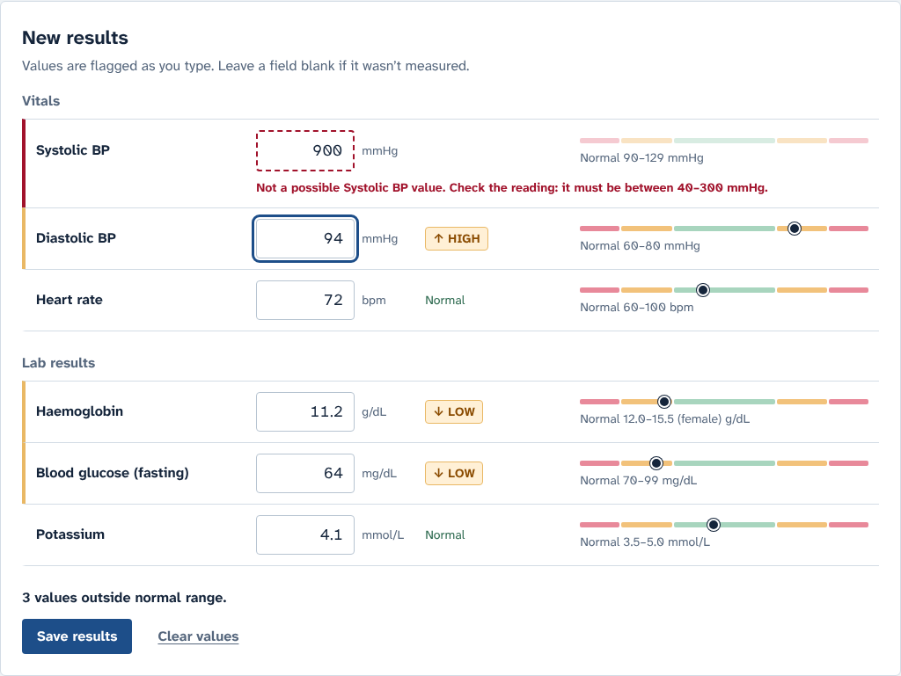
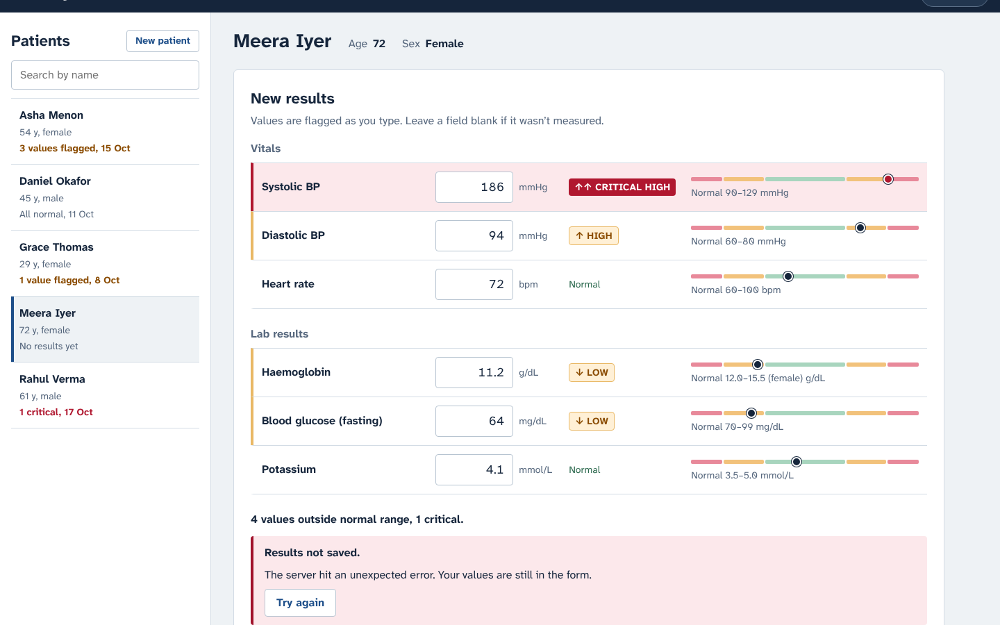
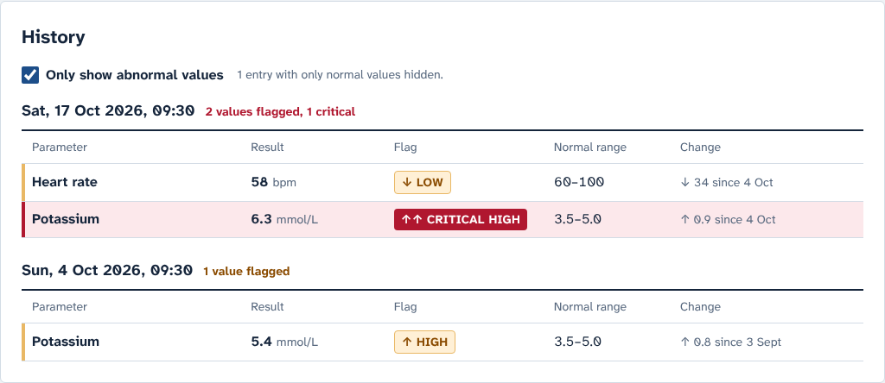
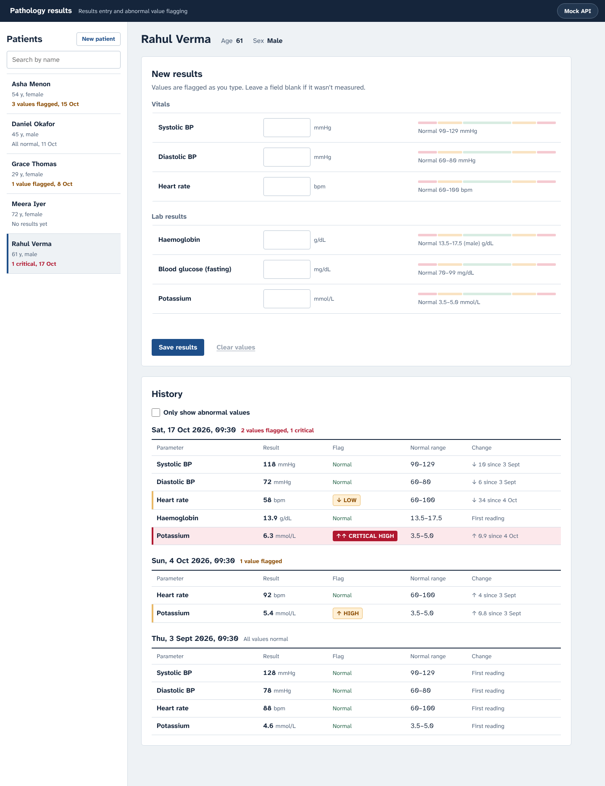
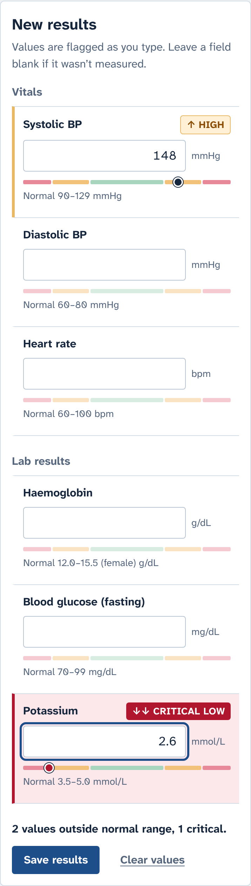
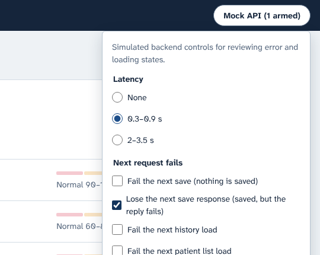

# Pathology Results Entry & Abnormal Value Flagging

**Track: Frontend** (UI against a mocked API) · Assignment 2

A nurse picks a patient, types vitals and lab values, and sees each value flagged as **LOW**, **HIGH**, **CRITICAL LOW** or **CRITICAL HIGH** as they type. Impossible readings are rejected as input errors, never shown as abnormal results. Saved entries build a per-patient history with an "only show abnormal values" filter and the change since the previous reading.



> **Demo:** _add your deployed link here_ (see [Deploying](#deploying)). Screenshots of every key flow are in [Demo screenshots](#demo-screenshots).

---

## Quick start

Requires **Node.js 20.19+** (or 22.12+) and npm.

```bash
git clone <this-repo-url>
cd pathology-results-entry
npm install
npm run dev          # open http://localhost:5173
```

No backend or database is needed: the mock API runs in the browser (a service worker). Data is seeded on every page load.

| Command                 | What it does                                                     |
| ----------------------- | ---------------------------------------------------------------- |
| `npm run dev`           | Start the app with hot reload                                    |
| `npm test`              | Run all tests once (Vitest)                                      |
| `npm run test:coverage` | Tests plus a coverage report                                     |
| `npm run typecheck`     | TypeScript, strict mode                                          |
| `npm run lint`          | ESLint (including a rule that keeps `src/domain` framework-free) |
| `npm run build`         | Type-check and build for production into `dist/`                 |
| `npm run preview`       | Serve the production build locally                               |

## What you can do

- **Patients**: list with each patient's latest result summary (for example "1 critical, 17 Oct"), search by name, add a patient (name, age, sex) with validation.
- **Enter results**: one form for six parameters, grouped as vitals and lab results. Every field shows its normal range and a small band gauge, and a value is flagged the moment it is typed. Blank fields mean "not measured".
- **Rejected input**: impossible values (systolic BP 900, negative haemoglobin), text, too many decimals, and diastolic ≥ systolic are shown as input errors once the nurse leaves the field (or tries to save), and block saving.
- **Safe saving**: a failed save keeps every typed value and offers **Try again**. Inputs are read-only while a save is in flight, so nothing typed can be lost. Retries reuse an idempotency key, so a save whose response was lost is never duplicated.
- **History**: newest first, with the server's classification, the normal range used at the time, and the change since the last time that parameter was measured. **Only show abnormal values** hides normal rows and entries with nothing abnormal. The filter is kept in the URL.
- **Guard rails**: switching patient with unsaved values asks before discarding them, and values are never carried over to another patient.
- **Bonus features**: sex-specific haemoglobin ranges, and the change from the previous value.

### Trying the failure and loading states

Use the **Mock API** button in the top-right corner:

| Control                                   | What to look for                                                                                        |
| ----------------------------------------- | ------------------------------------------------------------------------------------------------------- |
| Latency 2–3.5 s                           | Loading skeletons, "Saving…" state, read-only inputs while saving                                       |
| Fail the next save                        | Error banner, values kept, **Try again** saves them                                                     |
| Lose the next save response               | Entry is saved but the reply fails. **Try again** returns the saved entry and history shows it **once** |
| Fail the next history / patient list load | Error state with **Try again**                                                                          |
| Reset demo data                           | Restores the seed data                                                                                  |

Seed patients cover each state: **Rahul Verma** (critical potassium), **Asha Menon** (rising blood pressure and glucose), **Grace Thomas** (low haemoglobin, improving), **Daniel Okafor** (all normal, so the abnormal filter shows its empty state), **Meera Iyer** (no results yet).

---

## Clinical Assumptions & Trade-offs

All of these live in configuration ([`src/config/referenceConfig.ts`](src/config/referenceConfig.ts), [`src/config/patientRules.ts`](src/config/patientRules.ts)), not in logic. The mock API serves the reference configuration from `GET /api/parameters`, and the UI never hard-codes a range.

### Reference ranges (illustrative adult values, not clinically authoritative)

| Parameter               | Unit   | Decimals | Normal                           | Critical at or beyond | Possible (else rejected) |
| ----------------------- | ------ | -------- | -------------------------------- | --------------------- | ------------------------ |
| Systolic BP             | mmHg   | 0        | 90–129                           | ≤ 70 or ≥ 180         | 40–300                   |
| Diastolic BP            | mmHg   | 0        | 60–80                            | ≤ 40 or ≥ 120         | 20–200                   |
| Heart rate              | bpm    | 0        | 60–100                           | ≤ 40 or ≥ 130         | 20–250                   |
| Haemoglobin             | g/dL   | 1        | Female 12.0–15.5, Male 13.5–17.5 | ≤ 7.0 or ≥ 20.0       | 1.0–25.0                 |
| Blood glucose (fasting) | mg/dL  | 0        | 70–99                            | ≤ 50 or ≥ 400         | 10–1500                  |
| Potassium               | mmol/L | 1        | 3.5–5.0                          | ≤ 2.8 or ≥ 6.2        | 1.0–10.0                 |

### Boundary decisions (the brief leaves these open)

| Question                                           | Decision                                                              | Why                                                                                                        |
| -------------------------------------------------- | --------------------------------------------------------------------- | ---------------------------------------------------------------------------------------------------------- |
| Is a value exactly on a normal limit normal?       | **Yes.** Potassium 3.5 and 5.0 are NORMAL                             | Reference intervals are conventionally reported and read as inclusive                                      |
| Is a value exactly on a critical limit critical?   | **Yes.** Potassium 6.2 is CRITICAL HIGH                               | Critical limits are alert thresholds. Reaching one should alert: an extra alert is safer than a missed one |
| Is a value exactly on a "possible" limit accepted? | **Yes.** Systolic 300 is accepted (as CRITICAL HIGH), 301 is rejected | Plausibility limits mark the edge of physically possible readings                                          |

The two inclusivity choices are flags (`normalRangeInclusive`, `criticalLimitInclusive`). The tests cover both settings, so flipping either is a one-line config change.

### Validation versus classification

- **Invalid**: the reading can't be right, so the nurse must fix it. Covers values outside the possible range, text, more decimals than the parameter allows, and diastolic ≥ systolic. These are rejected by the form and by the API (`400` with field errors) and never get a LOW/HIGH/CRITICAL label.
- **Classified**: valid readings get NORMAL, LOW, HIGH, CRITICAL LOW or CRITICAL HIGH. Critical is checked first, so it always wins.

### Other assumptions

- **Adults only.** Registration accepts ages 18–120. Paediatric ranges differ, and silently applying adult ranges to a child would be unsafe.
- **Sex** is female or male, used only to choose reference ranges (haemoglobin here). Other values are out of scope; see limitations.
- **Glucose is fasting, in mg/dL.** Random glucose would need a different range and a "sample type" field.
- **Partial entries are fine.** Any field can be left blank (not measured), but an entry needs at least one value.
- **Decimal separator is "."**; "12,5", "1e2" and "0x10" are rejected rather than guessed.
- **The server sets the time** of an entry when it is saved (no back-dating).
- **"Abnormal" includes critical.** The filter shows anything that is not NORMAL.
- **History keeps a snapshot of the ranges used** when each value was classified, so changing the config later does not rewrite past flags.
- **Live flags are a preview; the server decides.** The form and the mock API run the same domain function, so they always agree, and history shows the server's classification.
- **Validation errors appear when the nurse leaves a field**, not while typing (typing "1" on the way to "120" is not an error), but flags update on every keystroke.

---

## Architecture overview

Full one-page overview with a diagram: **[docs/ARCHITECTURE.md](docs/ARCHITECTURE.md)**. The mocked API contract: **[docs/API.md](docs/API.md)**.

```
src/
  domain/      Pure TypeScript business rules: parse → validate → classify, changes, patient rules (no React)
  config/      Reference ranges, boundary policy, cross-field and patient rules (data only)
  api/         HTTP contract types, typed fetch client (ApiError), TanStack Query hooks
  mocks/       MSW handlers = the "backend": validation, classification, in-memory DB, seed, fault injection
  features/    patients/ (list, create, page) · results-entry/ (form) · history/ (history + filter)
  components/  FlagBadge, RangeGauge, loading/empty/error states
  app/         Routes, layout, query client
```

In short:

- **One framework-free clinical module.** `src/domain` holds every rule and is used by both the mock backend (authoritative) and the form (live preview). An ESLint rule fails the build if it imports React, MSW or any outer layer.
- **Server state lives in TanStack Query; form state stays in the form.** No global store is needed.
- **The UI depends only on the HTTP contract.** Switching to a real API means deleting the two lines in `src/main.tsx` that start the mock.

**Stack:** React 19, TypeScript (strict), Vite 7, React Router 7, TanStack Query 5, MSW 2, Vitest 4 with Testing Library and jsdom. Type is Atkinson Hyperlegible Next, designed for legibility, with clearly distinct 0/O and 1/l.

## Testing

```bash
npm test                # 331 tests across 12 files
npm run test:coverage   # src/domain: 100% lines; whole app: about 90% lines
```

The suite is weighted towards the riskiest logic:

| Layer                                                    | What is tested                                                                                                                                                                                         | Why                                                                                                                                |
| -------------------------------------------------------- | ------------------------------------------------------------------------------------------------------------------------------------------------------------------------------------------------------ | ---------------------------------------------------------------------------------------------------------------------------------- |
| **Classification boundaries** (`classification.test.ts`) | For every parameter and both sexes: below, exact and above every limit (possible, critical and normal), generated from the config, plus hand-written examples from the brief                           | Boundary values are where classification bugs hide. Generating the cases from config keeps the tests correct when ranges are tuned |
| **Boundary policy**                                      | Same values under inclusive and exclusive policy                                                                                                                                                       | Shows the open question is configuration, not code                                                                                 |
| **Validation** (`validation.test.ts`)                    | Parsing (`1e2`, `12,5`, `--1`, `.5`, `5.`), decimals, possible limits, cross-field rule, empty entry, unknown parameters, string numbers in API payloads                                               | Impossible input must be rejected, not classified                                                                                  |
| **Config integrity** (`referenceConfig.test.ts`)         | `possible < critical < normal ≤ normal < critical < possible` for every parameter and sex; limits typeable at the configured precision                                                                 | A typo in a range should fail CI, not mis-flag a patient                                                                           |
| **Mock API integration** (`mockApi.integration.test.ts`) | Real client against MSW: server-side classification, newest-first history, 400 field errors, 404, 500, and **idempotent retry after a lost response**                                                  | The contract the UI depends on                                                                                                     |
| **UI integration** (`ResultEntry.integration.test.tsx`)  | Live flags with text labels; impossible values block saving; **a failed save keeps typed values and retry saves them**; no duplicate after a lost response; sex-specific ranges; unsaved-changes guard | The brief's core user journeys, end to end through the real app                                                                    |
| **Views and components**                                 | History filter (including its URL state, empty and error states), patient list (error and retry, search, create with validation), `FlagBadge` text label for every classification                      | "Not colour alone" and every async state                                                                                           |

The tests were also checked against deliberate bugs: flipping a boundary policy, clearing the form on a failed save, and removing the server's idempotency check each made the relevant tests fail. Before submitting, the production build was driven in a real browser (Chromium) through every flow above, including a 390 px mobile layout with no horizontal scrolling.

## Known limitations and what I would do next

**Limitations (by design for the Frontend track):**

- **In-memory data.** A page reload restores the seed data.
- **No authentication or roles.** The app assumes a single nurse role. A real system would check permissions on the server for every patient.
- **No editing or deleting of saved entries.** Clinical records are usually corrected through an audit trail, not edited in place.
- **Ranges are adult-only.** There is no age-specific range and no choice of sample type (fasting or random glucose).
- **Sex is binary and only selects ranges.** Real systems need a more inclusive model, for example sex at birth plus a clinically chosen range set.
- **No runtime validation of API responses.** The client trusts the contract types.
- **Unsaved drafts are not kept.** Closing the tab loses typed values (the browser warns first). A real form would keep the draft in session storage.

**Next steps, in priority order:**

1. **Acknowledge critical values.** Require the nurse to confirm before saving any critical value, and record who confirmed it (an audit trail).
2. **Validate API responses at runtime** (for example with zod) and share the schema with a real backend.
3. **Let nurses set the time a sample was taken**, so results can be entered after the fact.
4. **Add a Playwright end-to-end smoke test** with an axe accessibility check in CI. The flows were checked in a real browser, but not yet automatically on each commit.
5. **Add a trend chart** per parameter in history.
6. **Support paediatric and other range sets** keyed by age band and sex, which the config shape already allows.

## AI tools

> ⚠️ **Ravindra: rewrite this section in your own words before submitting.** The reviewers read it closely and will ask about it in the interview. The facts below are accurate; the two "TODO" items can only come from you.

**What AI was used for:** This project was built with Claude (Anthropic) as an AI pair-programmer. Claude:

- helped choose the assignment and plan the architecture;
- wrote most of the implementation, the tests and these docs, from my requirements and the brief;
- ran the test suite and drove the built app in a headless browser to check each flow.

**What I reviewed and changed manually:** _TODO: list what you read line by line, what you changed, and why. For example the boundary decisions, the reference ranges, the copy, or the layout._

**One example where I disagreed with the AI:** _TODO: give a real example from your own review. If you didn't disagree with anything, say so honestly and describe the closest thing: something you questioned and then accepted, and why._

Corrections that came out of verifying the work (not personal disagreements), which may be useful to mention:

- The first build put the whole mock backend in the main bundle (676 kB). It was split into its own chunk, loaded before the app starts.
- The browser check showed the floating Mock API button covering form fields on a phone, and the history tables misaligned between entries. It was moved into the top bar, and the table columns were fixed.
- If a nurse edits values after a failed save, retrying with the old idempotency key could return the stale saved entry and silently drop the edit. The key is now regenerated whenever the values change after a save attempt.

## Deploying

The app is a static site, and the mock service worker runs in production too.

- **Vercel:** import the repo. Framework is Vite, build `npm run build`, output `dist`. [`vercel.json`](vercel.json) rewrites deep links to `index.html`.
- **Netlify:** build `npm run build`, publish `dist`. [`public/_redirects`](public/_redirects) handles deep links.

Service workers need HTTPS or localhost, which both hosts provide.

## Demo screenshots

|                                                                        |                                                                                               |
| ---------------------------------------------------------------------- | --------------------------------------------------------------------------------------------- |
| **Live flags while typing**        | **Impossible value is an input error, not a flag**  |
| **Failed save keeps the values**  | **Only abnormal values**                             |
| **Patient page with history**    | **Mobile (390 px)**                                     |
| **Mock API controls**          |                                                                                               |
