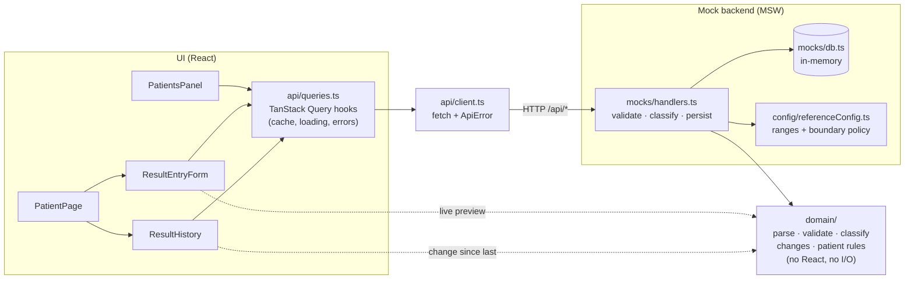

# Architecture overview

A React + TypeScript single-page app against a mocked HTTP API. One rule shapes the codebase: **clinical logic lives in one framework-free module, and everything else depends on it, never the other way round.**

## Layers

| Folder           | Responsibility                                                                                                                                                                             | May import                                          |
| ---------------- | ------------------------------------------------------------------------------------------------------------------------------------------------------------------------------------------ | --------------------------------------------------- |
| `src/domain`     | Pure business rules: parsing input, validation (is it possible?), classification (is it normal?), change from previous value, patient rules. 100% line coverage (`npm run test:coverage`). | nothing outside itself (enforced by an ESLint rule) |
| `src/config`     | Data, not logic: reference ranges, boundary policy, cross-field rules, patient rules.                                                                                                      | `domain` types                                      |
| `src/mocks`      | The "backend": MSW handlers, in-memory DB, seed data, simulated latency and failures, and the Mock API panel.                                                                              | `domain`, `config`, `api/contracts`                 |
| `src/api`        | The HTTP contract (`contracts.ts`), a typed `fetch` client that turns every failure into an `ApiError`, and TanStack Query hooks.                                                          | `domain` types                                      |
| `src/features`   | Screens: patients list and creation, results entry, history.                                                                                                                               | everything above                                    |
| `src/components` | Small shared UI: flag badge, range gauge, loading/empty/error states.                                                                                                                      | `domain`                                            |

## Tracing a save

1. The nurse types into `ResultEntryForm`. Each keystroke runs `assessFormValues()` from `domain/assessment.ts` against the config from `GET /api/parameters`. That gives a live flag per field, or a validation error once the field has been left.
2. **Save results**: if the assessment is invalid, focus moves to the first bad field and nothing is sent. Otherwise `useSaveResult` sends `POST /api/patients/:id/results` with the numbers and a `clientRequestId`.
3. The MSW handler runs the **same** domain pipeline (`assessSubmission()`) on the untrusted payload, so the server is authoritative. It rejects with `400` and field errors, or stores the classified entry with a snapshot of the ranges used.
4. On success the hook puts the server's entry at the top of the cached history, then refetches history and the patient list in the background. The form clears.
5. On failure the form keeps every value and shows **Try again**, which reuses the same `clientRequestId`. If the first attempt actually saved (a lost response), the server returns that entry instead of saving a duplicate.

## Key decisions

- **Validation is separate from classification.** `validate` decides whether a value is possible; `classify` only ever sees valid values. An impossible reading (systolic 900) can never show up as "CRITICAL".
- **The UI previews, the server decides.** The live flags and the server use one shared function, so they can't disagree. History always shows the server's classification.
- **Configuration over code.** Ranges, boundary inclusivity, decimal precision, plausibility limits and cross-field rules are data. Tests derive their boundary cases from that data and check that the configuration is internally consistent.
- **Server state in TanStack Query, form state local.** No global store: the only cross-screen state is server data, which the query cache already owns.
- **URL holds view state.** The "only abnormal" filter is a query parameter, so refresh, back/forward and shared links keep it.
- **Patient safety in the form.** The form is keyed by patient id, so a draft can never carry over to another patient. Leaving with unsaved values asks first, and inputs are read-only while a save is in flight.
- **Swappable backend.** Pointing the app at a real API means removing the two lines in `main.tsx` that start the mock. `api/client.ts` and the contract stay the same.
